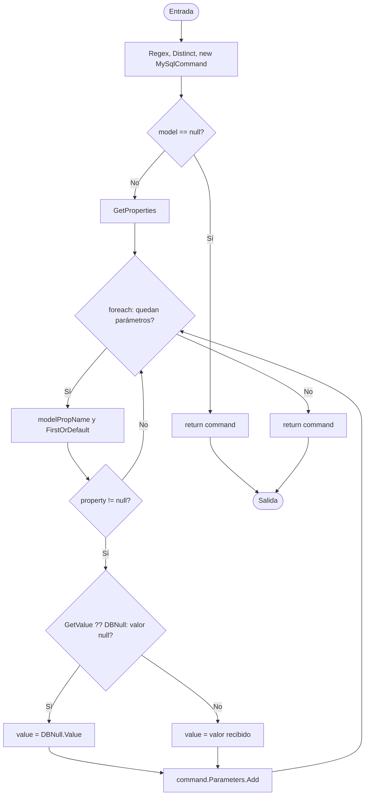

# V(G) y casos unitarios — DbParameterHelper.PopulateCommandParameters<T>(string, T)

**Archivo:** MicroServices/MicroServicioUsuario.API/MicroServicoUser.Inf/Persistence/Database/DbParameterHelper.cs  
**Líneas:** 10–41  
**Grafo de referencia:** docs/testing/usuarios/control-flow-graphs.md, sección "DbParameterHelper.PopulateCommandParameters<T>" (verificado contra el código actual: coincide en decisiones, retornos y bucle).  
**Pruebas:** MicroServices/MicroServicioUsuario.API/MicroServicioUsuario.Tests/DbParameterHelperPopulateCommandParametersTests.cs

## Grafo de flujo de control

Nodos: ENTRY/EXIT, bloques de instrucciones y tres decisiones más el operador `??`.

## Valores de V(G) por los tres métodos

Grafo completo con ENTRY y EXIT, un único componente conexo (P = 1).

| Magnitud | Valor | Cálculo |
|---|---:|---|
| N (nodos) | 14 | ENTRY, B1, D1, BR, B2, L, B3, D2, D3, B4a, B4b, B4, BE, EXIT |
| E (aristas) | 17 | ENTRY→B1, B1→D1, D1→BR, D1→B2, BR→EXIT, B2→L, L→B3, L→BE, B3→D2, D2→D3, D2→L, D3→B4a, D3→B4b, B4a→B4, B4b→B4, B4→L, BE→EXIT |
| P (componentes) | 1 | — |
| Regiones | 5 | 4 internas + 1 externa |
| Nodos predicado | 4 | D1, L, D2, D3; predicados + 1 = 5 |
| **V(G) = E − N + 2P** | **5** | 17 − 14 + 2 |
| **V(G) = regiones** | **5** | |
| **V(G) = predicados + 1** | **5** | 4 + 1 |

**Discrepancias:** ninguna entre los tres cálculos. Las tres fórmulas coinciden en 5.

**Nota sobre el operador `??`:** en el grafo se modela como decisión (D3) porque el compilador lo genera como bifurcación real: la rama de valor `null` y la de valor no nulo. La cobertura de Coverlet confirma esta lectura: la línea 32 del método aparece como línea con dos ramas (2/2). Si se omitiera `??` del grafo, la métrica bajaría a V(G) = 4 (E = 13, N = 11, predicados = 3). Se usa 5 porque es el valor que coincide con la bifurcación real del código y con el grafo del documento de referencia.

**Nota sobre Coverlet:** la columna `complexity` del reporte de Coverlet para la clase es 10. Es una métrica distinta, calculada sobre IL y no sobre el grafo de fuente. No se usa como V(G) del ticket.

## Caminos independientes (conjunto base)

| Camino | Recorrido | Caso |
|---|---|---|
| P1 | ENTRY → B1 → D1(Sí) → BR → EXIT | CP1 |
| P2 | ENTRY → B1 → D1(No) → B2 → L(agotado) → BE → EXIT | CP2 |
| P3 | … → L(Sí) → B3 → D2(Sí) → D3(No) → B4b → B4 → L(agotado) → BE → EXIT | CP3 |
| P4 | … → L(Sí) → B3 → D2(Sí) → D3(Sí) → B4a → B4 → L(agotado) → BE → EXIT | CP4 |
| P5 | … → L(Sí) → B3 → D2(No) → L(agotado) → BE → EXIT | CP5 |

Cada arista del grafo aparece al menos en un camino del conjunto. Con 5 caminos, V(G) = 5 caminos base.

## Casos de prueba y relación con V(G)

| ID | Prueba | Camino / justificación |
|---|---|---|
| CP1 | PopulateCommandParameters_WhenModelIsNull_ReturnsCommandWithoutParameters | P1 |
| CP2 | PopulateCommandParameters_WhenQueryHasNoPlaceholders_ReturnsCommandWithoutParameters | P2 |
| CP3 | PopulateCommandParameters_WhenPropertyValueIsNotNull_AddsParameterWithModelValue | P3 |
| CP4 | PopulateCommandParameters_WhenPropertyValueIsNull_AddsParameterWithDbNullValue | P4 |
| CP5 | PopulateCommandParameters_WhenPlaceholderHasNoMatchingProperty_DoesNotAddParameter | P5 |
| CA6 | PopulateCommandParameters_WhenPlaceholderIsRepeated_AddsSingleParameter | Sin camino nuevo: verifica `Distinct()` (llamada, no decisión). |
| CA7 | PopulateCommandParameters_WhenSeveralPlaceholdersExist_AddsOnlyMatchingParametersInQueryOrder | Sin camino nuevo: fuerza varias iteraciones del bucle con mezcla de coincidencias y omisiones, y verifica el orden. |
| CA8 | PopulateCommandParameters_WhenPlaceholderDiffersOnlyByCase_DoesNotAddParameter | Sin camino nuevo: caracteriza la comparación ordinal y sensible a mayúsculas de `p.Name == modelPropName` (dentro de la lambda, no expandida en el grafo). |

**Total de casos unitarios: 8.**

**Relación con V(G):** 8 = V(G) (5) + 3 casos adicionales. Los 5 primeros cubren exactamente los 5 caminos independientes. Los 3 adicionales no abren ramas nuevas en el grafo: verifican comportamiento dependiente de datos (`Distinct`), iteración repetida del bucle y la semántica de comparación de nombres. Se incluyen para cubrir comportamiento observable que los caminos por sí solos no prueban.

## Cobertura (Coverlet, suite completa)

- Líneas del método: 100 %.
- Ramas del método: 100 % (2/2 en las líneas 12, 20, 25, 30 y 32).

## Ejecución

Resultado de la suite completa en una exportación limpia de HEAD con los nuevos archivos: 28 de 28 pruebas pasan (20 existentes + 8 nuevas).
