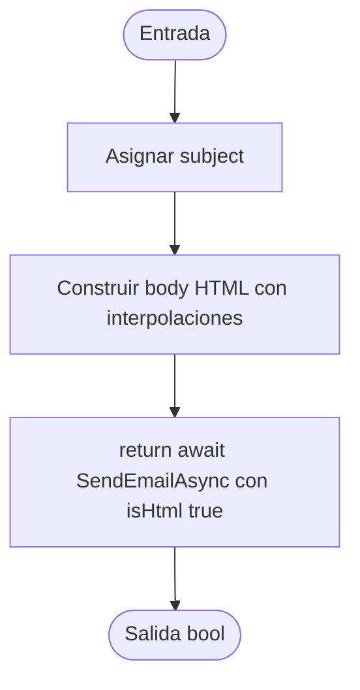

# V(G) y casos unitarios — EmailService.SendNewUserCredentialsAsync(string, string, string, string)

**Archivo:** MicroServices/MicroServicioUsuario.API/MicroServicioUser.App/Services/EmailService.cs  
**Líneas:** 24–88  
**Grafo de referencia:** docs/testing/usuarios/control-flow-graphs.md, sección "EmailService.SendNewUserCredentialsAsync" (verificado contra el código actual: asunto constante, plantilla HTML interpolada y una sola delegación a `SendEmailAsync` con `isHtml: true`, sin decisiones).  
**Pruebas:** MicroServices/MicroServicioUsuario.API/MicroServicioUsuario.Tests/EmailServiceSendNewUserCredentialsTests.cs

## Grafo de flujo de control

Nodos: ENTRY/EXIT y tres bloques de instrucciones. No hay decisiones, bucles, retornos anticipados ni `try/catch`. La plantilla HTML se trata como un bloque; sus interpolaciones no crean ramas.

## Valores de V(G) por los tres métodos

Grafo completo con ENTRY y EXIT, un único componente conexo (P = 1).

| Magnitud | Valor | Cálculo |
|---|---:|---|
| N (nodos) | 5 | ENTRY, B1, B2, B3, EXIT |
| E (aristas) | 4 | ENTRY→B1, B1→B2, B2→B3, B3→EXIT |
| P (componentes) | 1 | — |
| Regiones | 1 | Sin ciclos: solo la región externa |
| Nodos predicado | 0 | Ninguno; predicados + 1 = 1 |
| **V(G) = E − N + 2P** | **1** | 4 − 5 + 2 |
| **V(G) = regiones** | **1** | |
| **V(G) = predicados + 1** | **1** | 0 + 1 |

**Discrepancias:** ninguna. Los tres cálculos coinciden en 1.

**Verificación con Coverlet:** la clase de estado async `EmailService/<SendNewUserCredentialsAsync>d__3` reporta `complexity="1"`, igual que V(G).

## Caminos independientes (conjunto base)

| Camino | Recorrido | Caso |
|---|---|---|
| P1 | ENTRY → B1 → B2 → B3 → EXIT | CP1 |

Único camino. Cubre las cuatro aristas del grafo.

## Casos de prueba y relación con V(G)

| ID | Prueba | Camino / justificación |
|---|---|---|
| CP1 | SendNewUserCredentialsAsync_WhenDelegateSucceeds_SendsHtmlWithCredentialsAndReturnsTrue | P1; verifica destinatario, asunto constante, `isHtml = true`, que el cuerpo contiene nombre, usuario y contraseña, y que el resultado `true` se devuelve. |
| CA2 | SendNewUserCredentialsAsync_WhenDelegateFails_ReturnsFalse | Sin camino nuevo: mismo P1 con un delegado que devuelve `false`; verifica que el resultado se propaga sin cambios. |

**Total de casos unitarios: 2.**

**Relación con V(G):** 2 = V(G) (1) + 1 caso adicional. CP1 cubre el único camino independiente. CA2 no abre ramas: solo verifica que el resultado del delegado no se transforma.

**Nota sobre el alcance:** la prueba verifica que el cuerpo contiene los datos interpolados, no el HTML completo, para no acoplar la prueba a cada cambio de maquetación.

## Cobertura (Coverlet, suite completa)

- Líneas 25–88 de `SendNewUserCredentialsAsync` (clase `<SendNewUserCredentialsAsync>d__3`): todas cubiertas.
- Ramas: 100 % (no hay ramas que cubrir).

## Ejecución

Suite completa en la rama `fix/PEB29`: 120 de 120 pruebas pasan (118 previas + 2 nuevas).
