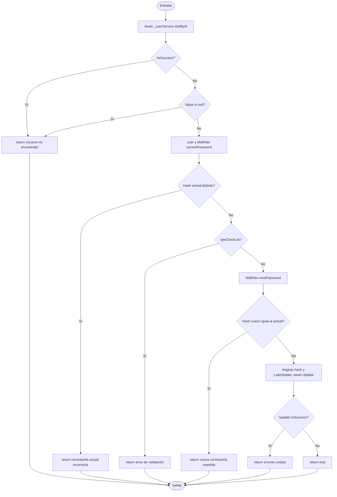

# V(G) y casos unitarios — Login.ChangePassword(int, string, string)

**Archivo:** MicroServices/MicroServicioUsuario.API/MicroServicoUser.Inf/Repository/Login.cs  
**Líneas:** 14–47  
**Grafo de referencia:** docs/testing/usuarios/control-flow-graphs.md, sección "Login.ChangePassword" (verificado contra el código actual: búsqueda con `GetById`, `||` de la línea 18, validación de la contraseña actual, `PasswordValidator.Validate`, comparación con la nueva, `Update` y los siete retornos).  
**Pruebas:** MicroServices/MicroServicioUsuario.API/MicroServicioUsuario.Tests/LoginChangePasswordTests.cs

## Grafo de flujo de control

Nodos: ENTRY/EXIT, bloques de instrucciones y seis decisiones. El `||` de la línea 18 se modela como dos decisiones, una por operando, porque el segundo solo se evalúa si el primero es falso. Los bloques de hash se tratan como llamadas; no se expanden.

## Valores de V(G) por los tres métodos

Grafo completo con ENTRY y EXIT, un único componente conexo (P = 1).

| Magnitud | Valor | Cálculo |
|---|---:|---|
| N (nodos) | 18 | ENTRY, B1, D1, D2, R1, B2, D3, R2, D4, R3, B3, D5, R4, B4, D6, R5, R6, EXIT |
| E (aristas) | 23 | ENTRY→B1, B1→D1, D1→R1, D1→D2, D2→R1, D2→B2, B2→D3, D3→R2, D3→D4, D4→R3, D4→B3, B3→D5, D5→R4, D5→B4, B4→D6, D6→R5, D6→R6, y R1…R6→EXIT (6) |
| P (componentes) | 1 | — |
| Regiones | 7 | 6 internas + 1 externa |
| Nodos predicado | 6 | D1 (`!IsSuccess`), D2 (`Value is null`), D3, D4, D5, D6; predicados + 1 = 7 |
| **V(G) = E − N + 2P** | **7** | 23 − 18 + 2 |
| **V(G) = regiones** | **7** | |
| **V(G) = predicados + 1** | **7** | 6 + 1 |

**Nota sobre el grafo de referencia:** el documento de control-flow-graphs.md separa cada bloque en su propio nodo (N1 a N19, con los bloques de validación y de `Md5Hex` como nodos independientes). Ese grafo tiene N = 19 y E = 24, y también da V(G) = 7. Fusionar bloques secuenciales no cambia la complejidad, así que el diagrama de este artefacto usa la versión simplificada.

**Discrepancias:** ninguna entre los tres cálculos de fuente; todos dan 7. Coverlet reporta `complexity="12"` para `<ChangePassword>d__2`. La diferencia no se desglosó al nivel IL: incluye las ramas del cortocircuito `||`, las comprobaciones de completado de los dos `await` y el lowering del compilador. No altera el conjunto de caminos, que deriva del grafo de fuente.

## Caminos independientes (conjunto base)

| Camino | Recorrido | Caso |
|---|---|---|
| P1 | ENTRY → B1 → D1(Sí) → R1 → EXIT | CP1 |
| P2 | ENTRY → B1 → D1(No) → D2(Sí) → R1 → EXIT | CP2 |
| P3 | … → D2(No) → B2 → D3(Sí) → R2 → EXIT | CP3 |
| P4 | … → D3(No) → D4(Sí) → R3 → EXIT | CP4 |
| P5 | … → D4(No) → B3 → D5(Sí) → R4 → EXIT | CP5 |
| P6 | … → D5(No) → B4 → D6(Sí) → R5 → EXIT | CP6 |
| P7 | … → D6(No) → R6 → EXIT | CP7 |

Los siete caminos cubren todas las aristas del grafo. Todos son alcanzables: P2 se obtiene con `Result<User?>.Success(null)`, un resultado que el repositorio devuelve cuando no hay usuario.

## Casos de prueba y relación con V(G)

| ID | Prueba | Camino |
|---|---|---|
| CP1 | ChangePassword_WhenLookupFails_ReturnsNotFoundWithoutUpdating | P1 |
| CP2 | ChangePassword_WhenLookupSucceedsWithoutUser_ReturnsNotFoundWithoutUpdating | P2 |
| CP3 | ChangePassword_WhenCurrentPasswordIsWrong_ReturnsErrorWithoutUpdating | P3 |
| CP4 | ChangePassword_WhenNewPasswordIsWeak_ReturnsValidationErrorWithoutUpdating | P4 |
| CP5 | ChangePassword_WhenNewPasswordEqualsCurrent_ReturnsErrorWithoutUpdating | P5 |
| CP6 | ChangePassword_WhenUpdateFails_ReturnsJoinedErrors | P6 |
| CP7 | ChangePassword_WhenAllChecksPass_PersistsNewHashAndReturnsSuccess | P7 |

**Total de casos unitarios: 7.**

**Relación con V(G):** 7 = V(G) (7). Un caso por camino independiente, sin casos adicionales: cada salida del método tiene su propia prueba, y ninguna rama queda sin ejercitar. CP7 además verifica que `FirstLogin` no cambia, porque el método de primer inicio es el que lo modifica.

**Nota sobre los hashes:** las pruebas construyen el usuario con `RegistrationHelpers.Md5Hex`, el mismo helper que usa el método, para que las comparaciones sean reales. Esto acopla la prueba al algoritmo MD5; un cambio de algoritmo exigiría ajustar los datos de prueba.

## Cobertura (Coverlet, suite completa)

- Líneas 15–47 de `ChangePassword` (clase `<ChangePassword>d__2`): todas cubiertas.
- Ramas: 100 % en las seis decisiones (líneas 18, 25, 30, 35, 43 y 4/4 en el `||`).

## Ejecución

Suite completa en la rama `fix/PEB42`: 133 de 133 pruebas pasan (126 previas + 7 nuevas).
