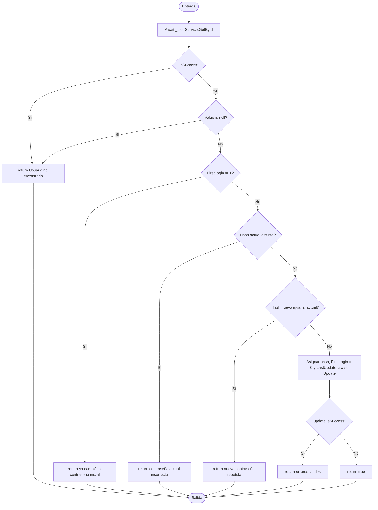

# V(G) y casos unitarios — Login.ChangePasswordFirstLogin(int, string, string)

**Archivo:** MicroServices/MicroServicioUsuario.API/MicroServicoUser.Inf/Repository/Login.cs  
**Líneas:** 49–76  
**Grafo de referencia:** docs/testing/usuarios/control-flow-graphs.md, sección "Login.ChangePasswordFirstLogin" (verificado contra el código actual: cinco `if` en las líneas 52, 57, 61, 66 y 73; el `||` de la línea 52 es cortocircuitado; retornos anticipados en cada rechazo).  
**Pruebas:** MicroServices/MicroServicioUsuario.API/MicroServicioUsuario.Tests/LoginChangePasswordFirstLoginTests.cs

## Grafo de flujo de control

Nodos: ENTRY/EXIT, bloques de instrucciones y seis decisiones. El `||` de la línea 52 se modela como dos decisiones, porque el segundo operando solo se evalúa si el primero es falso. Los bloques de hash se tratan como llamadas.

## Valores de V(G) por los tres métodos

Grafo completo con ENTRY y EXIT, un único componente conexo (P = 1).

| Magnitud | Valor | Cálculo |
|---|---:|---|
| N (nodos) | 16 | ENTRY, B1, D1, D2, R1, D3, R2, D4, R3, D5, R4, B2, D6, R5, R6, EXIT |
| E (aristas) | 21 | ENTRY→B1, B1→D1, D1→R1, D1→D2, D2→R1, D2→D3, D3→R2, D3→D4, D4→R3, D4→D5, D5→R4, D5→B2, B2→D6, D6→R5, D6→R6, y R1…R6→EXIT (6) |
| P (componentes) | 1 | — |
| Regiones | 7 | 6 internas + 1 externa |
| Nodos predicado | 6 | D1 (`!IsSuccess`), D2 (`Value is null`), D3, D4, D5, D6; predicados + 1 = 7 |
| **V(G) = E − N + 2P** | **7** | 21 − 16 + 2 |
| **V(G) = regiones** | **7** | |
| **V(G) = predicados + 1** | **7** | 6 + 1 |

**Nota:** el número de nodos y aristas depende de cuánto se fusionen los bloques secuenciales. Esta versión fusiona los bloques de hash con la asignación final; cualquier otra fusión de bloques secuenciales mantiene V(G) = 7.

**Discrepancias:** ninguna entre los tres cálculos de fuente. Coverlet reporta `complexity="12"` para `<ChangePasswordFirstLogin>d__3`, el mismo valor que en `Login.ChangePassword`. Igual que allí, no lo desglosé al nivel IL: incluye el cortocircuito del `||` y los `await`. No altera el conjunto de caminos.

## Caminos independientes (conjunto base)

| Camino | Recorrido | Caso |
|---|---|---|
| P1 | ENTRY → B1 → D1(Sí) → R1 → EXIT | CP1 |
| P2 | ENTRY → B1 → D1(No) → D2(Sí) → R1 → EXIT | CP2 |
| P3 | … → D2(No) → D3(Sí) → R2 → EXIT | CP3 |
| P4 | … → D3(No) → D4(Sí) → R3 → EXIT | CP4 |
| P5 | … → D4(No) → D5(Sí) → R4 → EXIT | CP5 |
| P6 | … → D5(No) → B2 → D6(Sí) → R5 → EXIT | CP6 |
| P7 | … → D6(No) → R6 → EXIT | CP7 |

Los siete caminos cubren todas las aristas del grafo. Todos son alcanzables: P2 se obtiene con `Result<User?>.Success(null)`.

## Casos de prueba y relación con V(G)

| ID | Prueba | Camino |
|---|---|---|
| CP1 | ChangePasswordFirstLogin_WhenLookupFails_ReturnsNotFoundWithoutUpdating | P1 |
| CP2 | ChangePasswordFirstLogin_WhenLookupSucceedsWithoutUser_ReturnsNotFoundWithoutUpdating | P2 |
| CP3 | ChangePasswordFirstLogin_WhenFirstLoginIsAlreadyDone_ReturnsErrorWithoutUpdating | P3 |
| CP4 | ChangePasswordFirstLogin_WhenCurrentPasswordIsWrong_ReturnsErrorWithoutUpdating | P4 |
| CP5 | ChangePasswordFirstLogin_WhenNewPasswordEqualsCurrent_ReturnsErrorWithoutUpdating | P5 |
| CP6 | ChangePasswordFirstLogin_WhenUpdateFails_ReturnsJoinedErrors | P6 |
| CP7 | ChangePasswordFirstLogin_WhenAllChecksPass_PersistsNewHashAndClearsFirstLogin | P7 |

**Total de casos unitarios: 7.**

**Relación con V(G):** 7 = V(G) (7). Un caso por camino independiente, sin adicionales. CP7 verifica además que `FirstLogin` pasa a 0, que es el efecto propio de este método.

## Observación: la nueva contraseña no se valida por complejidad

A diferencia de `Login.ChangePassword` (líneas 29–31), este método **no** llama a `PasswordValidator.Validate`. Eso significa que en el primer inicio de sesión se acepta cualquier contraseña distinta de la actual, incluida una débil como `"abc"`. El grafo de referencia tampoco incluye esa decisión, así que no es un camino que cubrir aquí.

No la fijé en una prueba como comportamiento esperado, porque podría ser un defecto y no una decisión de diseño. Conviene confirmar con el equipo si el primer inicio debe exigir las mismas reglas de complejidad. Si la respuesta es sí, hay que añadir una decisión (`!pwCheck.ok`) al grafo, lo que pasaría V(G) a 8, y un caso nuevo.

## Cobertura (Coverlet, suite completa)

- Líneas 50–76 de `ChangePasswordFirstLogin` (clase `<ChangePasswordFirstLogin>d__3`): todas cubiertas.
- Ramas: 100 % en las seis decisiones (líneas 52 con 4/4, 57, 61, 66 y 73).

## Ejecución

Suite completa en la rama `fix/PEB43`: 140 de 140 pruebas pasan (133 previas + 7 nuevas).
