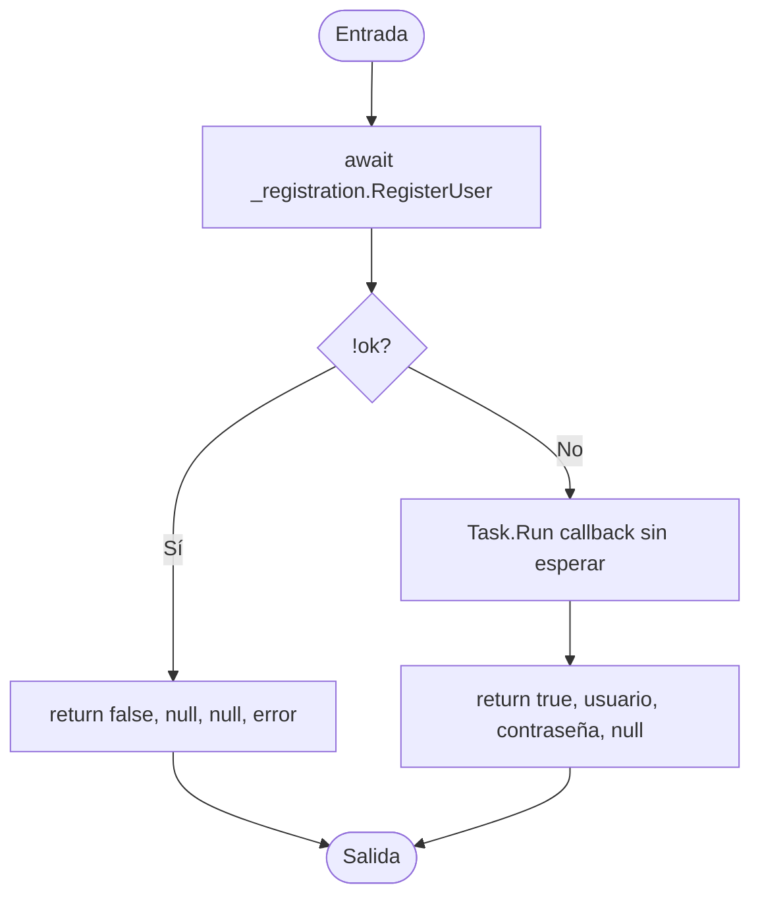
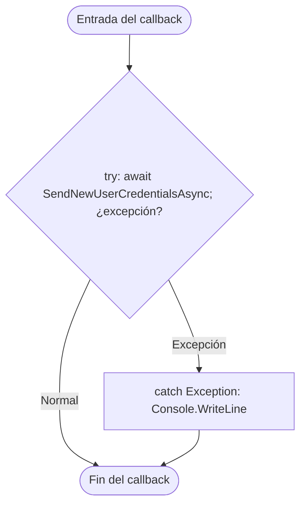

# V(G) y casos unitarios — RegistrationService.RegisterUser(string, string, string, string, int)

**Archivo:** MicroServices/MicroServicioUsuario.API/MicroServicioUser.App/Services/RegistrationService.cs  
**Líneas:** 25–44 (cuerpo) y 32–42 (callback de `Task.Run`)  
**Grafo de referencia:** docs/testing/usuarios/control-flow-graphs.md, sección "RegistrationService.RegisterUser" (verificado contra el código actual: coinciden la llamada a `_registration.RegisterUser`, la decisión `!ok`, el `Task.Run` que no se espera, el `try/catch` del callback y los dos retornos).  
**Pruebas:** MicroServices/MicroServicioUsuario.API/MicroServicioUsuario.Tests/RegistrationServiceRegisterUserTests.cs

El método tiene dos unidades de flujo: el cuerpo, que devuelve antes de que termine el envío, y el callback del `Task.Run`, que corre aparte. Cada una tiene su propio grafo y su propio V(G).

## Unidad 1: cuerpo del método

### Grafo

Nodos: ENTRY/EXIT, bloques de instrucciones y una decisión. El `Task.Run` se representa como un bloque: su contenido no se expande aquí.

### Valores de V(G)

| Magnitud | Valor | Cálculo |
|---|---:|---|
| N (nodos) | 7 | ENTRY, B1, D1, RF, SCH, RT, EXIT |
| E (aristas) | 7 | ENTRY→B1, B1→D1, D1→RF, D1→SCH, RF→EXIT, SCH→RT, RT→EXIT |
| P (componentes) | 1 | — |
| Regiones | 2 | 1 externa + 1 interna, que cierra el ciclo D1-RF-EXIT-RT-SCH-D1 |
| Nodos predicado | 1 | D1; predicados + 1 = 2 |
| **V(G) = E − N + 2P** | **2** | 7 − 7 + 2 |
| **V(G) = regiones** | **2** | E − N + 2 = 2 caras: externa y una interna que cierra D1-RF-EXIT-RT-SCH-D1 |
| **V(G) = predicados + 1** | **2** | 1 + 1 |

**Discrepancias:** ninguna. Los tres cálculos coinciden en 2. Coverlet reporta `complexity="2"` para `<RegisterUser>d__3`, igual que V(G).

### Caminos independientes

| Camino | Recorrido | Caso |
|---|---|---|
| P1 | ENTRY → B1 → D1(Sí) → RF → EXIT | CP1 |
| P2 | ENTRY → B1 → D1(No) → SCH → RT → EXIT | CP2 |

## Unidad 2: callback del Task.Run

### Grafo

Nodos: ENTRY/EXIT, el bloque `try` con su llamada `await` y el bloque `catch`. La salida normal y la excepción se modelan desde el `try`, como indica la convención del documento de referencia para los `catch`.

### Valores de V(G)

| Magnitud | Valor | Cálculo |
|---|---:|---|
| N (nodos) | 4 | ENTRY, TRY, CATCH, EXIT |
| E (aristas) | 4 | ENTRY→TRY, TRY→EXIT, TRY→CATCH, CATCH→EXIT |
| P (componentes) | 1 | — |
| Regiones | 2 | E − N + 2 = 2 caras |
| Nodos predicado | 1 | TRY (normal vs. excepción); predicados + 1 = 2 |
| **V(G) = E − N + 2P** | **2** | 4 − 4 + 2 |
| **V(G) = regiones** | **2** | |
| **V(G) = predicados + 1** | **2** | 1 + 1 |

**Discrepancias:** ninguna entre los tres cálculos de fuente. Coverlet reporta `complexity="1"` para el callback (`<<RegisterUser>b__0>d`): no cuenta el `catch` como ramificación. Es la misma convención de excepción que usa el grafo del documento; la diferencia es de herramienta, no del código.

### Caminos independientes

| Camino | Recorrido | Caso |
|---|---|---|
| Q1 | ENTRY → TRY(normal) → EXIT | CP3 |
| Q2 | ENTRY → TRY(excepción) → CATCH → EXIT | CP4 |

## Casos de prueba y relación con V(G)

| ID | Prueba | Unidad / camino |
|---|---|---|
| CP1 | RegisterUser_WhenRegistrationFails_ReturnsFailureAndDoesNotSendEmail | Cuerpo P1 |
| CP2 | RegisterUser_WhenRegistrationSucceeds_ReturnsCredentialsAndSchedulesEmail | Cuerpo P2 |
| CP3 | RegisterUser_ScheduledEmail_SendsCredentialsToRegisteredAddress | Callback Q1 |
| CP4 | RegisterUser_WhenScheduledEmailFails_StillReturnsSuccess | Callback Q2 |

**Total de casos unitarios: 4.**

**Relación con V(G):** la suma de V(G) de las dos unidades es 2 + 2 = 4, y hay 4 casos, uno por camino. No se añadieron casos adicionales: ninguno aportaría un camino nuevo ni un dato que cambie el flujo.

## Limitaciones de la prueba del callback

- El callback corre en segundo plano. Las pruebas esperan a que el envío se invoque (`TaskCompletionSource` con timeout de 5 s), sin `Thread.Sleep`.
- El `Console.WriteLine` del `catch` no se verifica: capturar `Console.Out` cambiaría estado global compartido por todas las pruebas. Su ejecución sí queda acreditada por la cobertura de líneas.
- CP1 comprueba que no hay envío inmediatamente después de retornar. Un defecto que agendara el envío con retraso no quedaría detectado por esa aserción.

## Cobertura (Coverlet, suite completa)

- Cuerpo `<RegisterUser>d__3`: líneas 26–44 cubiertas; rama de la línea 29 (`!ok`) al 100 % (2/2).
- Callback `<<RegisterUser>b__0>d`: líneas cubiertas, incluido el `catch`; ramas al 100 %.

## Ejecución

Suite completa en la rama `test/usuarios-app-registrationservice-registeruser-vg`: 114 de 114 pruebas pasan (110 previas + 4 nuevas).
