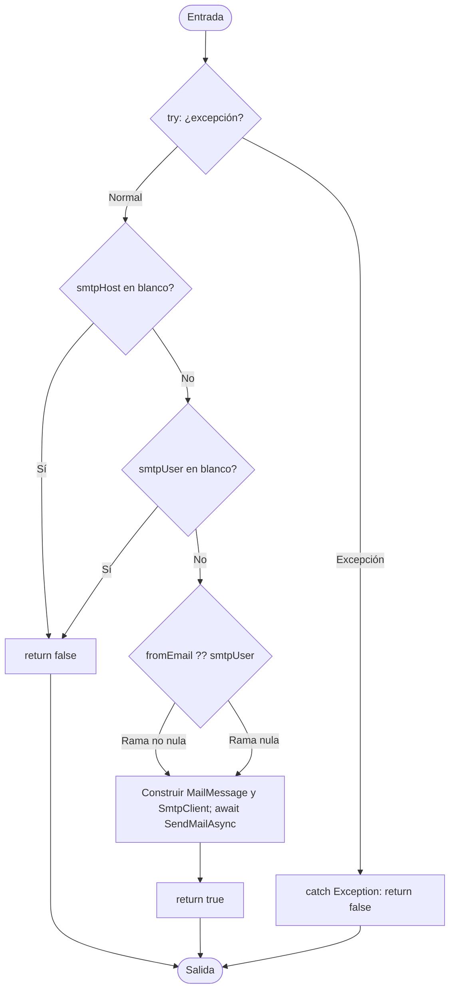

# V(G) y casos unitarios — SmtpEmailAdapter.SendEmailAsync(string, string, string, bool)

**Archivo:** MicroServices/MicroServicioUsuario.API/MicroServicoUser.Inf/EmailAdapters/SmtpEmailAdapter.cs  
**Líneas:** 18–55  
**Grafo de referencia:** docs/testing/usuarios/control-flow-graphs.md, sección "SmtpEmailAdapter.SendEmailAsync" (verificado contra el código actual: `try` que envuelve todo el cuerpo, `||` de la línea 29 con dos operandos, `??` de la línea 36, `await SendMailAsync` y `catch (Exception)` que devuelve `false`).  
**Pruebas:** MicroServices/MicroServicioUsuario.API/MicroServicioUsuario.Tests/SmtpEmailAdapterSendEmailTests.cs

## Grafo de flujo de control

Nodos: ENTRY/EXIT, el `try` como nodo de decisión (normal o excepción), las dos comprobaciones de configuración, el operador `??` del remitente, el bloque de envío y los retornos. El `catch` se conecta desde el `try`, según la convención del documento de referencia. El `||` de la línea 29 se modela como dos decisiones.

## Valores de V(G) por los tres métodos

Grafo completo con ENTRY y EXIT, un único componente conexo (P = 1).

| Magnitud | Valor | Cálculo |
|---|---:|---|
| N (nodos) | 10 | ENTRY, T, D1, D2, D3, B, RT, RF, CATCH, EXIT |
| E (aristas) | 13 | ENTRY→T, T→D1, T→CATCH, D1→RF, D1→D2, D2→RF, D2→D3, D3→B (rama no nula), D3→B (rama nula), B→RT, RF→EXIT, RT→EXIT, CATCH→EXIT |
| P (componentes) | 1 | — |
| Regiones | 5 | E − N + 2 = 5 caras; la pareja de aristas paralelas D3→B forma una cara propia |
| Nodos predicado | 4 | T (excepción), D1, D2, D3; predicados + 1 = 5 |
| **V(G) = E − N + 2P** | **5** | 13 − 10 + 2 |
| **V(G) = regiones** | **5** | |
| **V(G) = predicados + 1** | **5** | 4 + 1 |

**Discrepancias:** ninguna. Los tres cálculos coinciden en 5.

**Verificación con Coverlet:** la clase de estado async `SmtpEmailAdapter/<SendEmailAsync>d__2` reporta `complexity="6"`, uno más que V(G). La diferencia no se desglosó al nivel IL: incluye las dos ramas del `||` y el `??`, y el lowering del `try`. No altera el conjunto de caminos.

## Caminos independientes (conjunto base)

| Camino | Recorrido | Caso | Estado |
|---|---|---|---|
| P1 | ENTRY → T(excepción) → CATCH → EXIT | CP3 y CP4 | Cubierto |
| P2 | ENTRY → T(normal) → D1(Sí) → RF → EXIT | CP1 | Cubierto |
| P3 | … → D1(No) → D2(Sí) → RF → EXIT | CP2 | Cubierto |
| P4 | … → D2(No) → D3(rama no nula) → B → RT → EXIT | — | **No cubierto** (requiere servidor SMTP con TLS) |
| P5 | … → D2(No) → D3(rama nula) → B → RT → EXIT | — | **No cubierto** (requiere servidor SMTP con TLS) |

**Por qué P4 y P5 no se cubren:** su único punto de diferencia respecto a las pruebas es el éxito de `SendMailAsync`. `SmtpClient` necesita un servidor real, y `EnableSsl = true` está fijo en el código, así que un servidor local sin TLS no sirve. Sin cambiar el código de producción (por ejemplo, inyectando el transporte), no hay forma de llegar al `return true` de forma aislada. Las dos ramas de D3 sí quedan cubiertas: CP3 toma la rama no nula y CP4 la rama nula, aunque ambas terminen en excepción.

## Casos de prueba y relación con V(G)

| ID | Prueba | Camino |
|---|---|---|
| CP1 | SendEmailAsync_WhenHostIsBlank_ReturnsFalse | P2 |
| CP2 | SendEmailAsync_WhenUserIsBlank_ReturnsFalse | P3 |
| CP3 | SendEmailAsync_WhenConnectionFailsWithFromEmail_ReturnsFalse | P1, rama no nula de `??` |
| CP4 | SendEmailAsync_WhenConnectionFailsWithoutFromEmail_ReturnsFalse | P1, rama nula de `??` |

**Total de casos unitarios: 4.**

**Relación con V(G):** V(G) = 5, con 3 caminos cubiertos de extremo a extremo y 2 no cubiertos (P4 y P5, que difieren solo en el éxito del envío). CP3 y CP4 comparten el camino P1 pero ejercitan los dos resultados de `??`, así que no son redundantes. No hay casos adicionales: el resto de los casos reales necesita SMTP.

**Pruebas de excepción:** CP3 y CP4 intentan conectarse a `127.0.0.1:1`, donde la conexión se rechaza de inmediato. La suite tarda unos 40 s en total por estos dos casos; si el puerto estuviera filtrado en algún equipo, la prueba esperaría el timeout de SMTP.

## Observación: FromEmail vacío no usa el fallback

`SmtpSettings.FromEmail` tiene por defecto `""`, no `null`. Según el código, `fromEmail ?? smtpUser` solo usa `smtpUser` cuando `fromEmail` es `null`. Con el valor por defecto, `new MailAddress("", fromName)` lanza una excepción, que el `catch` convierte en `false`. El envío fallaría siempre sin aviso con esa configuración. No lo verifiqué ejecutando el código; lo deduje de la lectura de `SmtpSettings` y de `SmtpEmailAdapter`. No lo fijé en una prueba porque parece un defecto de configuración y no un comportamiento deseado. Conviene confirmarlo y decidir si el fallback debe tratar también la cadena vacía.

## Cobertura (Coverlet, suite completa)

- Líneas 19–55: 96,15 %. La única línea sin cubrir es la 48 (`return true`), que pertenece al camino de éxito que no se puede aislar.
- Ramas: 100 % (4/4 en `||` de la línea 29, 2/2 en `??` de la línea 36).

## Ejecución

Suite completa en la rama `fix/PEB62`: 144 de 144 pruebas pasan (140 previas + 4 nuevas). Tiempo total de la suite: unos 40 s por las pruebas de conexión rechazada.
