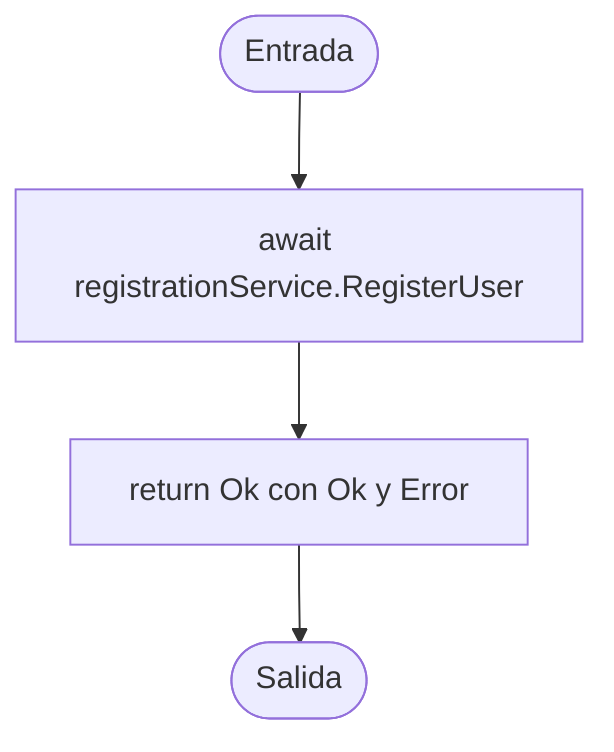

# V(G) y casos unitarios — UserController.Register(RegisterDTO)

**Archivo:** MicroServices/MicroServicioUsuario.API/MicroServicioUsuario/Controllers/UserController.cs  
**Líneas:** 79–83  
**Grafo de referencia:** docs/testing/usuarios/control-flow-graphs.md, sección "UserController.Register" (verificado contra el código actual: una llamada `await registrationService.RegisterUser(...)` y un retorno `Ok`, sin decisiones).  
**Pruebas:** MicroServices/MicroServicioUsuario.API/MicroServicioUsuario.Tests/UserControllerRegisterTests.cs

## Grafo de flujo de control

Nodos: ENTRY/EXIT y dos bloques de instrucciones. No hay decisiones, bucles, retornos anticipados ni `try/catch`.

## Valores de V(G) por los tres métodos

Grafo completo con ENTRY y EXIT, un único componente conexo (P = 1).

| Magnitud | Valor | Cálculo |
|---|---:|---|
| N (nodos) | 4 | ENTRY, B1, B2, EXIT |
| E (aristas) | 3 | ENTRY→B1, B1→B2, B2→EXIT |
| P (componentes) | 1 | — |
| Regiones | 1 | Sin ciclos: solo la región externa |
| Nodos predicado | 0 | Ninguno; predicados + 1 = 1 |
| **V(G) = E − N + 2P** | **1** | 3 − 4 + 2 |
| **V(G) = regiones** | **1** | |
| **V(G) = predicados + 1** | **1** | 0 + 1 |

**Discrepancias:** ninguna. Los tres cálculos coinciden en 1.

**Verificación con Coverlet:** la clase de estado async `UserController/<Register>d__7` reporta `complexity="1"`, igual que V(G).

## Caminos independientes (conjunto base)

| Camino | Recorrido | Caso |
|---|---|---|
| P1 | ENTRY → B1 → B2 → EXIT | CP1 |

Único camino. Cubre las tres aristas del grafo.

## Casos de prueba y relación con V(G)

| ID | Prueba | Camino / justificación |
|---|---|---|
| CP1 | Register_WhenRegistrationSucceeds_ReturnsOkWithOkTrueAndNullError | P1; verifica `Ok = true`, `Error = null` y que los datos del DTO llegan al servicio de registro. |
| CA2 | Register_WhenRegistrationFails_ReturnsOkWithOkFalseAndError | Sin camino nuevo: mismo P1 con registro fallido; verifica que el mensaje de error se devuelve en `Error`. |

**Total de casos unitarios: 2.**

**Relación con V(G):** 2 = V(G) (1) + 1 caso adicional. CP1 cubre el único camino independiente. CA2 no abre ramas: verifica que el controlador refleja el resultado de error sin transformarlo.

**Nota sobre las dependencias:** `RegistrationService` es una clase concreta, así que se prueba con un `IRegistration` falso y un `EmailService` sobre un `IEmailService` falso. El correo solo se programa en el camino de éxito y no se verifica aquí; ese comportamiento queda cubierto por las pruebas de `RegistrationService.RegisterUser`.

## Cobertura (Coverlet, suite completa)

- Líneas 80–83 de `Register` (clase `<Register>d__7`): todas cubiertas.
- Ramas: 100 % (no hay ramas que cubrir).

## Ejecución

Suite completa en la rama `fix/PEB9`: 118 de 118 pruebas pasan (116 previas + 2 nuevas).
