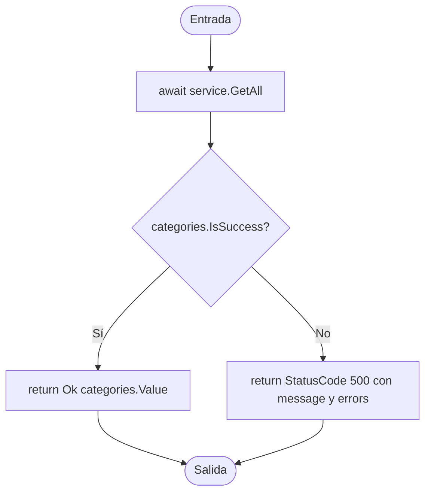

# V(G) y casos unitarios — UserController.Select()

**Archivo:** MicroServices/MicroServicioUsuario.API/MicroServicioUsuario/Controllers/UserController.cs  
**Líneas:** 86–101  
**Grafo de referencia:** docs/testing/usuarios/control-flow-graphs.md, sección "UserController.Select" (verificado contra el código actual: coincide en la llamada a `service.GetAll()`, la decisión `IsSuccess` y los dos retornos).  
**Pruebas:** MicroServices/MicroServicioUsuario.API/MicroServicioUsuario.Tests/UserControllerSelectTests.cs

## Grafo de flujo de control

Nodos: ENTRY/EXIT, bloques de instrucciones y una decisión. No hay bucles, retornos anticipados ni `try/catch`; las excepciones de `service.GetAll()` no se capturan en el método.

## Valores de V(G) por los tres métodos

Grafo completo con ENTRY y EXIT, un único componente conexo (P = 1).

| Magnitud | Valor | Cálculo |
|---|---:|---|
| N (nodos) | 6 | ENTRY, B1, D1, B2, B3, EXIT |
| E (aristas) | 6 | ENTRY→B1, B1→D1, D1→B2, D1→B3, B2→EXIT, B3→EXIT |
| P (componentes) | 1 | — |
| Regiones | 2 | 1 interna (D1-B2-EXIT-B3) + 1 externa |
| Nodos predicado | 1 | D1; predicados + 1 = 2 |
| **V(G) = E − N + 2P** | **2** | 6 − 6 + 2 |
| **V(G) = regiones** | **2** | |
| **V(G) = predicados + 1** | **2** | 1 + 1 |

**Discrepancias:** ninguna. Los tres cálculos coinciden en 2.

**Verificación con Coverlet:** la clase de estado async `UserController/<Select>d__8` reporta `complexity="2"`, el mismo valor que V(G). Ambas lecturas coinciden, a diferencia del método del ticket anterior, donde Coverlet difería del grafo de fuente.

## Caminos independientes (conjunto base)

| Camino | Recorrido | Caso |
|---|---|---|
| P1 | ENTRY → B1 → D1(Sí) → B2 → EXIT | CP1 |
| P2 | ENTRY → B1 → D1(No) → B3 → EXIT | CP2 |

Cada arista aparece en al menos un camino. Con 2 caminos, V(G) = 2.

## Casos de prueba y relación con V(G)

| ID | Prueba | Camino / justificación |
|---|---|---|
| CP1 | Select_WhenGetAllSucceeds_ReturnsOkWithUsers | P1 |
| CP2 | Select_WhenGetAllFails_ReturnsInternalServerErrorWithMessageAndErrors | P2 |
| CA3 | Select_WhenGetAllFailsWithSeveralErrors_ReturnsAllErrorsInOrder | Sin camino nuevo: mismo camino P2 con varios errores; verifica que se conservan todos en orden. |
| CA4 | Select_WhenGetAllSucceedsWithoutUsers_ReturnsOkWithEmptyCollection | Sin camino nuevo: mismo camino P1 con colección vacía. |

**Total de casos unitarios: 4.**

**Relación con V(G):** 4 = V(G) (2) + 2 casos adicionales. Los dos primeros cubren los dos caminos independientes. Los adicionales no abren ramas nuevas: verifican que el valor de éxito y el de error se transportan sin pérdida (lista vacía y lista de errores con varios elementos).

## Cobertura (Coverlet, suite completa)

- Líneas de `Select` (clase `<Select>d__8`): todas las líneas ejecutables cubiertas.
- Ramas: 100 % (2/2) en la línea 89 (`IsSuccess`).

## Ejecución

Suite completa en la rama `test/usuarios-api-usercontroller-select-vg`: 91 de 91 pruebas pasan (87 previas + 4 nuevas).
