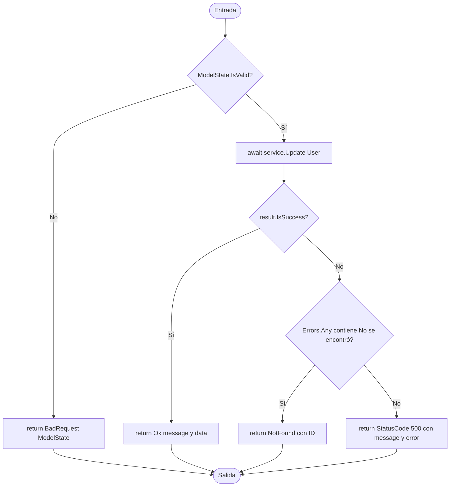

# V(G) y casos unitarios — UserController.Update(User)

**Archivo:** MicroServices/MicroServicioUsuario.API/MicroServicioUsuario/Controllers/UserController.cs  
**Líneas:** 180–216  
**Grafo de referencia:** docs/testing/usuarios/control-flow-graphs.md, sección "UserController.Update" (verificado contra el código actual: coinciden la validación de `ModelState`, la llamada a `service.Update`, la decisión de éxito, la clasificación por "No se encontró" y los cuatro retornos).  
**Pruebas:** MicroServices/MicroServicioUsuario.API/MicroServicioUsuario.Tests/UserControllerUpdateTests.cs

## Grafo de flujo de control

Nodos: ENTRY/EXIT, bloques de instrucciones y tres decisiones. Hay dos retornos anticipados implícitos en el flujo (`BadRequest` por modelo inválido y el resto de salidas por `return`). No hay bucles ni `try/catch`. `result.Errors.Any(e => e.Contains(...))` se trata como una llamada única, sin expandir su lambda.

## Valores de V(G) por los tres métodos

Grafo completo con ENTRY y EXIT, un único componente conexo (P = 1).

| Magnitud | Valor | Cálculo |
|---|---:|---|
| N (nodos) | 10 | ENTRY, D1, BR, B1, D2, B2, D3, B3, B4, EXIT |
| E (aristas) | 12 | ENTRY→D1, D1→BR, D1→B1, BR→EXIT, B1→D2, D2→B2, D2→D3, B2→EXIT, D3→B3, D3→B4, B3→EXIT, B4→EXIT |
| P (componentes) | 1 | — |
| Regiones | 4 | 3 internas + 1 externa |
| Nodos predicado | 3 | D1, D2, D3; predicados + 1 = 4 |
| **V(G) = E − N + 2P** | **4** | 12 − 10 + 2 |
| **V(G) = regiones** | **4** | |
| **V(G) = predicados + 1** | **4** | 3 + 1 |

**Discrepancias:** ninguna entre los tres cálculos de fuente; todos dan 4.

**Verificación con Coverlet (no es V(G)):** la clase de estado `UserController/<Update>d__12` reporta `complexity="6"`. La diferencia no se resolvió al nivel IL: Coverlet cuenta ramas del código compilado (incluidas las del `await` y la expansión de la interpolación y del `Any`), mientras que V(G) se calcula sobre el grafo de fuente. Es la misma situación del ticket de `DbParameterHelper`, pero aquí no pude explicar los dos puntos extra sin desensamblar. No altera el conjunto de caminos, que se deriva del grafo de fuente y cubre las 12 aristas.

## Caminos independientes (conjunto base)

| Camino | Recorrido | Caso |
|---|---|---|
| P1 | ENTRY → D1(No) → BR → EXIT | CP1 |
| P2 | ENTRY → D1(Sí) → B1 → D2(Sí) → B2 → EXIT | CP2 |
| P3 | ENTRY → D1(Sí) → B1 → D2(No) → D3(Sí) → B3 → EXIT | CP3 |
| P4 | ENTRY → D1(Sí) → B1 → D2(No) → D3(No) → B4 → EXIT | CP4 |

Los cuatro caminos cubren las 12 aristas del grafo.

## Casos de prueba y relación con V(G)

| ID | Prueba | Camino / justificación |
|---|---|---|
| CP1 | Update_WhenModelStateIsInvalid_ReturnsBadRequestWithoutCallingService | P1; además verifica que el servicio no se llama. |
| CP2 | Update_WhenServiceSucceeds_ReturnsOkWithMessageAndUser | P2 |
| CP3 | Update_WhenUserIsNotFound_ReturnsNotFound | P3 |
| CP4 | Update_WhenAnotherErrorOccurs_ReturnsInternalServerErrorWithMessageAndErrors | P4 |
| CA5 | Update_WhenUserIsNotFound_MessageUsesReceivedUserId | Sin camino nuevo: mismo P3; verifica que el mensaje usa el ID del usuario recibido. |
| CA6 | Update_WhenAnotherErrorsOccurWithSeveralErrors_ReturnsAllErrorsInOrder | Sin camino nuevo: mismo P4 con varios errores; se conservan todos en orden. |
| CA7 | Update_WhenAnyErrorContainsNotFoundText_ReturnsNotFound | Sin camino nuevo: mismo P3 con errores mixtos; verifica que `Any` basta con un error que contenga el texto. |

**Total de casos unitarios: 7.**

**Relación con V(G):** 7 = V(G) (4) + 3 casos adicionales. Los cuatro primeros cubren los caminos independientes. Los adicionales no abren ramas nuevas: verifican el ID en el mensaje, la conservación de errores y la semántica de `Any` sobre una lista mixta.

**Nota sobre el ModelState:** el estado inválido se fuerza con `ModelState.AddModelError`. No se prueba la validación por atributos de `User`, porque eso pertenece a la infraestructura de ASP.NET y no a este método.

## Cobertura (Coverlet, suite completa)

- Líneas de `Update` (clase `<Update>d__12`): todas las líneas ejecutables cubiertas.
- Ramas: 100 % (2/2) en las líneas 183 (`ModelState.IsValid`) y 190 (`result.IsSuccess`).

## Ejecución

Suite completa en la rama `test/usuarios-api-usercontroller-update-vg`: 106 de 106 pruebas pasan (99 previas + 7 nuevas).
