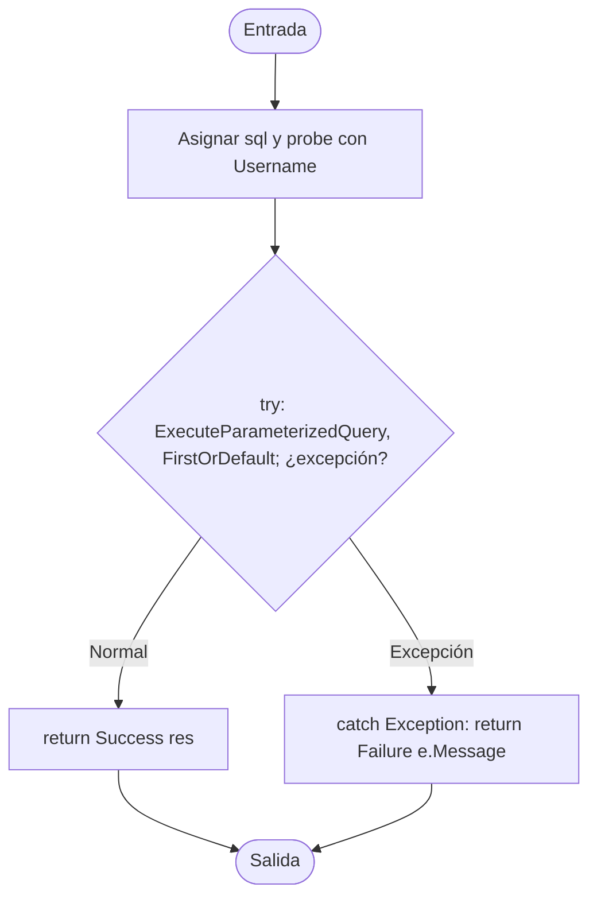

# V(G) y casos unitarios — UserRepository.GetByUsername(string)

**Archivo:** MicroServices/MicroServicioUsuario.API/MicroServicoUser.Inf/Repository/UserRepository.cs  
**Líneas:** 196–225  
**Grafo de referencia:** docs/testing/usuarios/control-flow-graphs.md, sección "UserRepository.GetByUsername" (verificado contra el código actual: query `WHERE username = @Username LIMIT 1`, `probe` con el username, `try` que envuelve la consulta y `FirstOrDefault`, `catch (Exception)` y los dos retornos).  
**Pruebas:** MicroServices/MicroServicioUsuario.API/MicroServicioUsuario.Tests/UserRepositoryGetByUsernameTests.cs

## Grafo de flujo de control

Nodos: ENTRY/EXIT, bloque de preparación (query y `probe`), el `try` como nodo de decisión (normal o excepción), el retorno normal y el `catch`. El `catch` se conecta desde el `try`, como en `UserRepository.GetById`.

## Valores de V(G) por los tres métodos

Grafo completo con ENTRY y EXIT, un único componente conexo (P = 1).

| Magnitud | Valor | Cálculo |
|---|---:|---|
| N (nodos) | 6 | ENTRY, B1, TRY, OK, CATCH, EXIT |
| E (aristas) | 6 | ENTRY→B1, B1→TRY, TRY→OK, TRY→CATCH, OK→EXIT, CATCH→EXIT |
| P (componentes) | 1 | — |
| Regiones | 2 | E − N + 2 = 2 caras |
| Nodos predicado | 1 | TRY (normal vs. excepción); predicados + 1 = 2 |
| **V(G) = E − N + 2P** | **2** | 6 − 6 + 2 |
| **V(G) = regiones** | **2** | |
| **V(G) = predicados + 1** | **2** | 1 + 1 |

**Discrepancias:** ninguna entre los tres cálculos de fuente. Coverlet reporta `complexity="1"` para la clase de estado `<GetByUsername>d__7`: no cuenta el `catch`, la misma diferencia de herramienta que en `RegistrationService.RegisterUser` y en `UserRepository.GetById`.

## Caminos independientes (conjunto base)

| Camino | Recorrido | Caso |
|---|---|---|
| P1 | ENTRY → B1 → TRY(normal) → OK → EXIT | CP1 |
| P2 | ENTRY → B1 → TRY(excepción) → CATCH → EXIT | CP2 |

Los dos caminos cubren las seis aristas del grafo.

## Casos de prueba y relación con V(G)

| ID | Prueba | Camino / justificación |
|---|---|---|
| CP1 | GetByUsername_WhenUserExists_ReturnsSuccessWithUser | P1; verifica que el resultado envuelve el mismo usuario, que la consulta contiene `WHERE username = @Username` y que el username llega en el modelo. |
| CP2 | GetByUsername_WhenQueryThrows_ReturnsFailureWithExceptionMessage | P2; verifica que la excepción no escapa y que su mensaje se devuelve como error. |
| CA3 | GetByUsername_WhenNoUserMatches_ReturnsSuccessWithNull | Sin camino nuevo: mismo P1 con la consulta sin filas; `FirstOrDefault` devuelve `null` y el resultado sigue siendo éxito. |

**Total de casos unitarios: 3.**

**Relación con V(G):** 3 = V(G) (2) + 1 caso adicional. CP1 y CP2 cubren los dos caminos independientes. CA3 no abre ramas.

**Observación sobre el SQL (no probada aquí):** a diferencia de `UserRepository.GetById`, la consulta de `GetByUsername` no filtra `status = TRUE`. Eso es comportamiento de la base de datos y no de la lógica de C#, así que no lo cubre una prueba unitaria con un `IMySqlConnectionManager` falso. Conviene revisarlo si se espera que solo los usuarios activos puedan iniciar sesión.

**Nota sobre el alcance:** la prueba usa un `IMySqlConnectionManager` falso. No valida el SQL real ni el mapeo de columnas.

## Cobertura (Coverlet, suite completa)

- Líneas 217–223 de `GetByUsername` (clase `<GetByUsername>d__7`): todas cubiertas, incluido el `catch` (líneas 221–223, 1 acierto).
- Ramas: 100 % (no hay ramas de C# que cubrir).

## Ejecución

Suite completa en la rama `fix/PEB40`: 126 de 126 pruebas pasan (123 previas + 3 nuevas).
