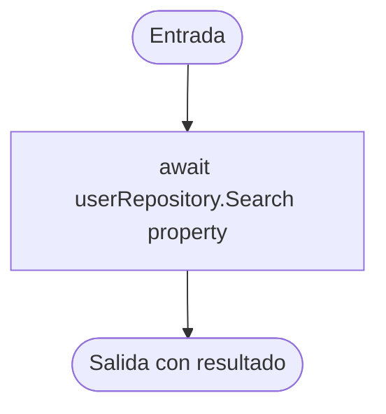

# V(G) y casos unitarios — UserService.Search(string)

**Archivo:** MicroServices/MicroServicioUsuario.API/MicroServicioUser.App/Services/UserService.cs  
**Líneas:** 53–56  
**Grafo de referencia:** docs/testing/usuarios/control-flow-graphs.md, sección "UserService.Search" (verificado contra el código actual: una sola llamada `await userRepository.Search(property)` y un retorno, sin decisiones).  
**Pruebas:** MicroServices/MicroServicioUsuario.API/MicroServicioUsuario.Tests/UserServiceSearchTests.cs

## Grafo de flujo de control

Nodos: ENTRY/EXIT y un bloque de instrucciones. No hay decisiones, bucles, retornos anticipados ni `try/catch`.

## Valores de V(G) por los tres métodos

Grafo completo con ENTRY y EXIT, un único componente conexo (P = 1).

| Magnitud | Valor | Cálculo |
|---|---:|---|
| N (nodos) | 3 | ENTRY, B1, EXIT |
| E (aristas) | 2 | ENTRY→B1, B1→EXIT |
| P (componentes) | 1 | — |
| Regiones | 1 | Sin ciclos: solo la región externa |
| Nodos predicado | 0 | Ninguno; predicados + 1 = 1 |
| **V(G) = E − N + 2P** | **1** | 2 − 3 + 2 |
| **V(G) = regiones** | **1** | |
| **V(G) = predicados + 1** | **1** | 0 + 1 |

**Discrepancias:** ninguna. Los tres cálculos coinciden en 1.

**Verificación con Coverlet:** la clase de estado async `UserService/<Search>d__7` reporta `complexity="1"`, igual que V(G).

## Caminos independientes (conjunto base)

| Camino | Recorrido | Caso |
|---|---|---|
| P1 | ENTRY → B1 → EXIT | CP1 |

Único camino. Cubre las dos aristas del grafo.

## Casos de prueba y relación con V(G)

| ID | Prueba | Camino / justificación |
|---|---|---|
| CP1 | Search_WhenRepositorySucceeds_ReturnsSameResultAndForwardsTerm | P1; verifica que el resultado llega sin cambios, que el término se reenvía tal cual y que el repositorio se llama una vez. |
| CA2 | Search_WhenRepositoryFails_ReturnsSameFailureAndErrors | Sin camino nuevo: mismo P1 con un repositorio fallido; verifica que el error y sus mensajes pasan sin modificar. |

**Total de casos unitarios: 2.**

**Relación con V(G):** 2 = V(G) (1) + 1 caso adicional. CP1 cubre el único camino independiente. CA2 no abre ramas: solo verifica que el servicio no transforma la respuesta de error del repositorio.

## Cobertura (Coverlet, suite completa)

- Líneas 54–56 de `Search` (clase `<Search>d__7`): todas cubiertas.
- Ramas: 100 % (no hay ramas que cubrir).

## Ejecución

Suite completa en la rama `test/usuarios-app-userservice-search-vg`: 110 de 110 pruebas pasan (108 previas + 2 nuevas).
